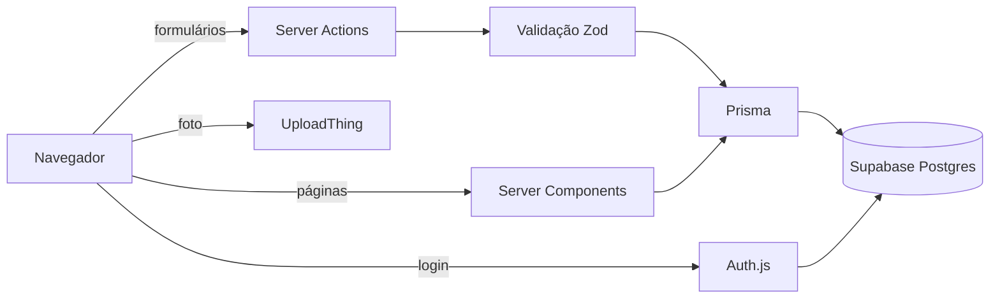

# 🪨 Diário de Campo

Catálogo de amostras de campo para geologia e meio ambiente. Registre cada coleta com **local no mapa,
data, tipo, foto e observações**, e depois consulte tudo em lista ou no mapa, com filtros.

**[Ver demo →](https://diario-de-campo-sigma.vercel.app/)**

## Funcionalidades

- **Login com GitHub ou Google**: cada usuário vê e edita apenas as próprias amostras.
- **Cadastro de amostras** de rocha, solo, água ou sedimento, com título, data da coleta e observações.
- **Escolha do local** clicando no mapa, pelo GPS do celular ou digitando as coordenadas.
- **Foto da amostra** enviada direto do formulário (até 4 MB).
- **Lista e mapa**: pontos coloridos por tipo, com popup e link para cada amostra.
- **Filtros** por tipo, período e título. Os filtros ficam na URL, então dá para salvar ou compartilhar o link de uma busca.
- **Validação** dos dados no servidor, com mensagens em português (coordenadas válidas, data que não está no futuro, campos obrigatórios).

## Stack

| Camada | Tecnologia |
|---|---|
| Framework | [Next.js 16](https://nextjs.org) (App Router, Server Components, Server Actions) + TypeScript |
| Interface | [Tailwind CSS 4](https://tailwindcss.com) + [shadcn/ui](https://ui.shadcn.com) |
| Banco | PostgreSQL no [Supabase](https://supabase.com) |
| ORM | [Prisma 7](https://www.prisma.io) com driver adapter `pg` |
| Autenticação | [Auth.js](https://authjs.dev) (NextAuth v5) com sessões salvas no banco |
| Validação | [Zod 4](https://zod.dev) |
| Mapa | [React-Leaflet](https://react-leaflet.js.org) + [OpenStreetMap](https://www.openstreetmap.org), sem chave de API |
| Upload | [UploadThing](https://uploadthing.com) (o banco guarda só a URL da foto) |
| Deploy | [Vercel](https://vercel.com) |

## Como funciona



Algumas decisões do projeto:

- **Os dados de cada usuário ficam isolados no servidor.** Toda consulta, edição e exclusão filtra por `userId`
  ([`src/lib/amostras.ts`](src/lib/amostras.ts), [`actions.ts`](src/app/amostras/actions.ts)). Abrir pela URL
  uma amostra de outra pessoa retorna 404.
- **O RLS fica ligado em todas as tabelas** (migration `habilitar_rls`). O Supabase expõe o schema `public`
  pela API REST com uma chave pública, e o RLS fecha esse acesso. O app não é afetado, porque o Prisma
  conecta como dono das tabelas.
- **Os formulários funcionam sem JavaScript.** As Server Actions e os filtros (um formulário `GET`) usam HTML puro;
  o JavaScript só melhora a experiência (mapa, GPS, upload).
- **O mapa só é carregado no navegador** (`next/dynamic` com `ssr: false`), porque o Leaflet depende de `window`.

## Modelo de dados

```prisma
enum TipoAmostra { ROCHA SOLO AGUA SEDIMENTO }

model Amostra {
  id          String      @id @default(cuid())
  userId      String
  titulo      String
  tipo        TipoAmostra
  latitude    Float
  longitude   Float
  dataColeta  DateTime    @db.Date
  observacoes String?
  fotoUrl     String?
  criadoEm    DateTime    @default(now())
  atualizadoEm DateTime   @updatedAt
}
```

`User`, `Account`, `Session` e `VerificationToken` são as tabelas padrão do Auth.js. O schema completo está em [`prisma/schema.prisma`](prisma/schema.prisma).

## Rodando localmente

Pré-requisito: Node.js 22 ou mais recente.

```bash
git clone https://github.com/Gabrielnambu/Diario-de-Campo.git
cd Diario-de-Campo
npm install
cp .env.example .env      # preencha conforme a seção abaixo
npm run db:deploy         # cria as tabelas no banco
npm run dev               # http://localhost:3000
```

### Variáveis de ambiente

| Variável | Obrigatória | Para que serve |
|---|---|---|
| `DATABASE_URL` | ✅ | Conexão usada pelo app (no Supabase, o pooler na porta **6543** com `?pgbouncer=true`) |
| `DIRECT_URL` | Supabase | Conexão usada pelas migrations (pooler na porta **5432**) |
| `AUTH_SECRET` | ✅ | Chave que protege as sessões. Gere com `npx auth secret` |
| `AUTH_GITHUB_ID` / `AUTH_GITHUB_SECRET` | um provedor | Login com GitHub |
| `AUTH_GOOGLE_ID` / `AUTH_GOOGLE_SECRET` | um provedor | Login com Google |
| `UPLOADTHING_TOKEN` | — | Upload de fotos. Sem ela, o formulário funciona sem o campo de foto |
| `AUTH_TRUST_HOST` | — | Use `true` só para rodar `npm start` fora da Vercel |

A tela de login mostra apenas os provedores que têm credenciais configuradas.

<details>
<summary><strong>Configurar o Supabase</strong></summary>

1. Crie um projeto em [supabase.com](https://supabase.com) e anote a senha do banco.
2. No projeto, clique em **Connect** → aba **ORMs** → **Prisma**.
3. Copie as duas URLs para `DATABASE_URL` (porta 6543) e `DIRECT_URL` (porta 5432), trocando `[YOUR-PASSWORD]` pela senha.

Para trabalhar sem internet, `npx prisma dev -d -n diario-de-campo` sobe um Postgres local e mostra a
`DATABASE_URL`. Nesse caso, deixe a `DIRECT_URL` vazia.
</details>

<details>
<summary><strong>Configurar o login com GitHub</strong></summary>

1. Acesse [github.com/settings/developers](https://github.com/settings/developers) → **OAuth Apps** → **New OAuth App**.
2. Em **Homepage URL**, coloque `http://localhost:3000`.
3. Em **Redirect URI**, coloque `http://localhost:3000/api/auth/callback/github`.
4. Copie o **Client ID** e gere um **Client secret**, depois cole nas variáveis `AUTH_GITHUB_*`.
</details>

<details>
<summary><strong>Configurar o login com Google</strong></summary>

1. No [Google Cloud Console](https://console.cloud.google.com), crie um projeto.
2. Em **APIs & Services → OAuth consent screen**, configure o app com público **External**. Enquanto o app
   estiver em modo de teste, adicione seu e-mail em **Test users**.
3. Em **Clients → Create client**, escolha **Web application**:
   - Authorized JavaScript origins: `http://localhost:3000`
   - Authorized redirect URIs: `http://localhost:3000/api/auth/callback/google`
4. Copie o Client ID e o Client secret para as variáveis `AUTH_GOOGLE_*`.
</details>

### Scripts

| Comando | O que faz |
|---|---|
| `npm run dev` | Servidor de desenvolvimento |
| `npm run build` / `npm start` | Build e servidor de produção |
| `npm run lint` | ESLint |
| `npm run db:migrate` | Cria uma migration a partir de mudanças no schema (desenvolvimento) |
| `npm run db:deploy` | Aplica as migrations pendentes no banco do `.env` |
| `npm run db:studio` | Abre o Prisma Studio para ver e editar os dados |

## Estrutura

```
prisma/
  schema.prisma              Modelos (Amostra + Auth.js)
  migrations/                Histórico de migrations, incluindo o RLS
src/
  auth.ts                    Auth.js: provedores, adapter Prisma, sessão
  app/
    amostras/
      page.tsx               Lista e mapa com filtros
      nova/                  Cadastro
      [id]/                  Detalhe e edição
      actions.ts             Server Actions: criar, editar e excluir
    login/                   Tela de login
    api/auth/                Rotas do Auth.js
    api/uploadthing/         Upload de foto (exige login)
  components/
    amostra-form.tsx         Formulário com mapa, GPS e upload
    mapa-leaflet.tsx         Mapa (exibição e escolha de local)
    filtros-amostras.tsx     Filtros salvos na URL
  lib/
    amostras.ts              Consultas ao banco, sempre filtradas por usuário
    validacao.ts             Schemas Zod
    prisma.ts                Prisma Client com o adapter pg
```

## Deploy na Vercel

1. Importe o repositório na Vercel.
2. Em **Environment Variables**, defina `DATABASE_URL` (porta 6543), `AUTH_SECRET` (gere um novo,
   diferente do de desenvolvimento), as credenciais OAuth e, se for usar fotos, o `UPLOADTHING_TOKEN`.
3. Antes do primeiro acesso, aplique as migrations no Supabase. Rode `npm run db:deploy` na sua máquina,
   com o `.env` apontando para o Supabase.
4. Adicione a URL de produção nos apps OAuth:
   `https://SEU-APP.vercel.app/api/auth/callback/github` (e/ou `/google`).

O Prisma Client é gerado no `postinstall`, então a Vercel não precisa de configuração extra. Cada `git push`
na `main` publica uma versão nova.

## Próximos passos

- [ ] Exportar as amostras em CSV ou GeoJSON
- [ ] Paginação na lista
- [ ] Mais de uma foto por amostra
- [ ] Modo offline para coletas sem sinal (PWA)
